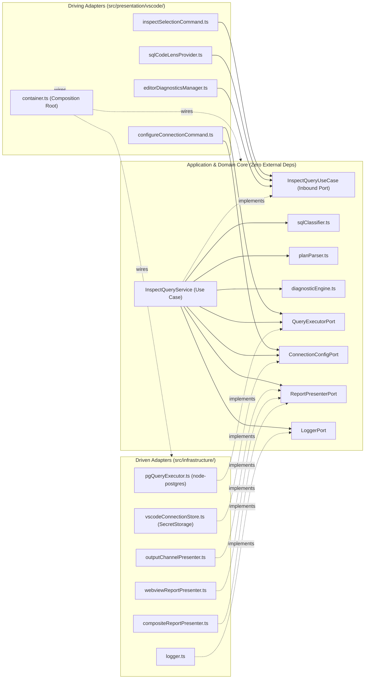

# Hexagonal Architecture Blueprint

QueryAutopsy implements **Hexagonal Architecture (Ports & Adapters)** to guarantee that PostgreSQL execution plan semantics, SQL safety classification, and diagnostic rules are completely decoupled from VS Code APIs and the `pg` driver.

## 1. System Topology

---

## 2. Layer Responsibilities & Contracts

### 2.1 `src/domain/` (Pure Business Logic)
- **Rules**: Imports ONLY from `src/domain/`. Zero `vscode`, zero `pg`, zero Node I/O.
- **Models**:
  - `queryRequest.ts`: `ExplainMode` (`'analyze' | 'estimate'`), `SqlStatementKind`, `ClassifiedSql`, `InspectQueryInput`, `ExplainExecutionRequest`.
  - `executionPlan.ts`: `ExecutionPlan`, `PlanNode`, `BufferMetrics`, `SortMetrics`.
  - `diagnostic.ts`: `DiagnosticSeverity`, `DiagnosticRuleId`, `DiagnosticFinding`, `IndexSuggestion`, `InspectionReport`.
- **Errors** (`errors/domainErrors.ts`): Explicit typed `DomainError` hierarchy (`EmptyQueryError`, `MultipleStatementsError`, `UnsafeQueryError`, `MissingParametersError`, `MissingConnectionError`, `InvalidPlanError`, `QueryExecutionError`).
- **Services**:
  - `sqlClassifier.ts`: Single-pass PostgreSQL lexical scanner + statement safety classification + positional parameter discovery.
  - `planParser.ts`: Validates raw JSON, calculates exclusive timing (`inclusive - children`), clamps parallel worker overlaps, preserves root cumulative buffers.
  - `diagnosticEngine.ts`: Extensible rule pipeline returning severity-sorted findings.

### 2.2 `src/application/` (Use Case Orchestration)
- `usecases/inspectQueryService.ts`: Implements `InspectQueryUseCase`.
- `usecases/applyIndexService.ts`: Implements `ApplyIndexUseCase` — validates single-statement `CREATE INDEX CONCURRENTLY` via `validateSafeCreateIndexSql`, resolves credentials from `ConnectionConfigPort`, and executes via `QueryExecutorPort.executeCreateIndex` only upon explicit user modal confirmation.
  1. Classifies SQL via `classifySqlStatement`.
  2. Enforces policy (`DDL`/`UNKNOWN` blocked; `WRITE` under `analyze` blocked unless `allowWriteAnalyze`).
  3. Validates positional parameter counts (`MissingParametersError`).
  4. Resolves connection string via `ConnectionConfigPort` (`MissingConnectionError`).
  5. Calls `QueryExecutorPort.executeExplain(...)`.
  6. Parses plan (`parsePostgreSqlPlan`) and runs diagnostics (`analyzeExecutionPlan`).
  7. Delivers `InspectionReport` to `ReportPresenterPort.present(report)`.

### 2.3 `src/infrastructure/` (Driven Adapters)
- `postgres/pgQueryExecutor.ts`: Caches a bounded `pg.Pool` (max 4 connections), executes `EXPLAIN` inside `BEGIN READ ONLY` / `BEGIN` + `SET LOCAL statement_timeout` + guaranteed `ROLLBACK` in `finally`. Maps SQLSTATE codes via `pgErrors.ts`.
- `vscode/vscodeConnectionStore.ts`: Reads/writes connection URI in `vscode.SecretStorage`; reads non-sensitive settings (`statementTimeoutMs`, `allowWriteAnalyze`, `seqScanRowThreshold`, `showRawJson`, `fallbackConnectionString`) from `vscode.workspace.getConfiguration('queryAutopsy')`.
- `vscode/outputChannelPresenter.ts`: Formats `InspectionReport` cleanly for the Output panel (Milestone 1).
- `vscode/webview/webviewReportPresenter.ts`: Renders the interactive Webview execution tree, KPI strip, diagnostics, and node inspector with strict CSP (`webviewHtml.ts`) and typed bridge messages (`contracts.ts`).
- `vscode/compositeReportPresenter.ts`: Fans out `InspectionReport` to both `WebviewReportPresenter` and `OutputChannelReportPresenter`.
- `vscode/logger.ts`: Structured timestamped logs to `QueryAutopsy Logs` OutputChannel.

### 2.4 `src/presentation/` & `src/extension.ts` (Driving Adapters & Composition Root)
- `presentation/vscode/container.ts`: Instantiates concrete adapters, injects them into `InspectQueryService`, registers VS Code commands, and returns a clean `dispose()` lifecycle handle.
- `presentation/vscode/commands/inspectSelectionCommand.ts`: Extracts active editor selection, handles `MissingConnectionError` (offers one-click configuration) and `MissingParametersError` (prompts for `$1..$n` bindings), and displays summary notifications.
- `presentation/vscode/commands/configureConnectionCommand.ts`: Validates URI format, tests DB connectivity, stores URI in `SecretStorage`.
- `extension.ts`: Minimal entry point (`activate` / `deactivate`).

---

## 3. Evolution Strategy (Milestones 2 & 3)

- **Composite Presentation (Milestone 2)**: Introduce a `CompositeReportPresenter` implementing `ReportPresenterPort` that delegates to both `WebviewReportPresenter` and `OutputChannelReportPresenter` (or swaps based on a setting), keeping `InspectQueryService` untouched.
- **SQL Extraction & CodeLens (Milestone 3)**: Implemented pure `extractSqlBlocks` in `src/domain/services/sqlBlockExtractor.ts`, `SqlCodeLensProvider` in `src/presentation/vscode/codelens/sqlCodeLensProvider.ts`, and `EditorDiagnosticsManager` (`DiagnosticCollection` + `CodeActionProvider`) in `src/presentation/vscode/diagnostics/editorDiagnosticsManager.ts`.
