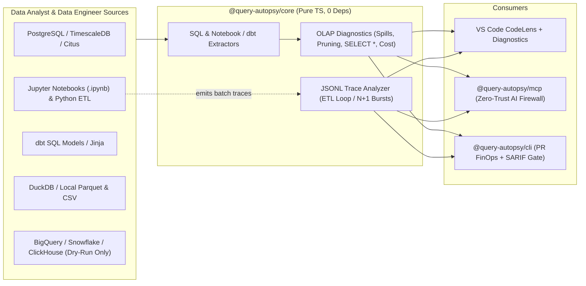

# QueryAutopsy Data & Analytics Roadmap (`v1.8.2` → `v1.9.x`)

**Role**: Principal Data Platform Architecture, FinOps Guardrails & Extension Strategy  
**Status**: Proposed (`docs/data-analytics-roadmap` — Ready for incremental PR execution)  
**Baseline Release**: `v1.8.1` (`ROADMAP-V1.1-TO-V2.0.md` delivered: `@query-autopsy/core`, CLI/SARIF, Zero-Trust MCP Firewall, Laravel / Node / Python trace bridges)  
**Target Starting Release**: **`v1.8.2`**

---

## 1. Strategic Vision & Positioning

While QueryAutopsy (`v1.0` → `v1.8.1`) excels at OLTP backend forensics (**PostgreSQL**, **MySQL**, **SQLite**, and ORM `N+1` bursts), **Data Analysts**, **Analytics Engineers (dbt)**, and **Data Engineers** face a distinct set of SQL pain points:

- **PostgreSQL / Relational Warehouses**: Large analytical `JOIN`s, `GROUP BY` / `ORDER BY` spilling out of `work_mem` onto disk (`EXTERNAL_DISK_SPILL`), stale ETL table statistics (`PLANNER_ROW_MISESTIMATE`), missing partition pruning on multi-million-row fact tables, and wide `SELECT *` scans.
- **Local Columnar & Lakehouse Workflows**: Inspecting **Parquet / CSV** datasets locally via **DuckDB** and querying inside **Jupyter Notebooks (`.ipynb`)** or **dbt** models.
- **Cloud Data Warehouses (`BigQuery`, `Snowflake`, `ClickHouse`)**: The critical metric shifts from missing B-Tree indexes to **Bytes Scanned (`GB`/`TB`), Partition Pruning, and Cloud Query Cost (`USD`)** — catching a `$400` full-table scan in the IDE, AI assistant (`MCP`), or Pull Request (`CLI`) *before* it executes.

> *"Bring the same Zero-Trust `EXPLAIN`-first safety and hexagonal diagnostics to Data Analysts, Analytics Engineers, and Data Engineers — starting incrementally in `v1.8.2` with zero regressions on OLTP workflows."*

---

## 2. Core Architectural Shifts (OLTP vs. OLAP / Analytics)

All extensions strictly preserve [`AGENTS.md`](../../AGENTS.md) layer boundaries:

1. **Workload Profile Awareness (`oltp` vs. `analytics`)**:
   - In transactional APIs, a `Seq Scan` over 50k rows almost always needs a `CREATE INDEX`.
   - In BI/analytical aggregations (`SUM`, `COUNT`, `GROUP BY` across full fact tables) or columnar storage (`DuckDB`, `Parquet`, `ClickHouse`, `BigQuery`), suggesting B-Tree `CREATE INDEX` statements is noisy or invalid.
   - `DiagnosticConfig` gains `workloadProfile?: 'auto' | 'oltp' | 'analytics'` so index rules stay focused on selective queries while OLAP rules evaluate spills, width, pruning, and scan cost.
2. **Extended Plan Metadata (`ExecutionPlan` / `PlanNode` optional fields)**:
   - Additive optional metrics in `packages/core/src/domain/models/executionPlan.ts`:
     - `bytesScanned?: number`
     - `estimatedCostUsd?: number`
     - `partitionsTotal?: number` / `partitionsScanned?: number`
     - `columnsReadCount?: number`
3. **Strict FinOps & Zero-Execution Default for Cloud Warehouses**:
   - Cloud adapters MUST default to **Dry-Run / Metadata `EXPLAIN` only** (`mode: 'estimate'`).
   - Live query execution (`ANALYZE`) stays disabled by default on billed cloud warehouses unless explicitly opted in under strict byte caps (`maxDryRunBytes`).
4. **Bundle Budget Protection for the VS Code Extension**:
   - Heavy third-party warehouse SDKs remain optional / dynamically loaded inside `@query-autopsy/executors` or CLI rather than inflating `query-autopsy.vsix`.

---

## 3. Target Data Ecosystem Topology

---

## 4. Incremental Delivery Plan (Starting at `v1.8.2`)

Every milestone ships in its own focused `<type>/<kebab-case-slug>` PR branch off `main` with full unit coverage and the mandatory verification gate (`check-types`, `lint`, `test`, `build`).

---

### Phase 1 — `v1.8.2`: PostgreSQL OLAP Diagnostics, Jupyter (`.ipynb`) & dbt SQL Prep
- **Target Version**: **`v1.8.2`**
- **Recommended Branch**: `feat/v1.8.2-analytics-olap-and-notebooks`
- **Why First**: Zero new heavy drivers required; immediately delivers high-value Data Engineering wins on PostgreSQL, Python notebooks, and dbt repositories.

#### Deliverables
1. **OLAP / Analytics Rules (`packages/core/src/domain/services/diagnosticEngine.ts`)**:
   - **`SELECT_STAR_WIDE_SCAN`**: Flags wide scans / `planWidth` bloat on large relations (`SELECT *` pulling unneeded columns or TOAST values during analytical joins).
   - **`MISSING_PARTITION_PRUNING`**: Inspects PostgreSQL `Append` / partitioned table plans when all partitions are scanned (`Subplans Removed` absent or zero relative to total child partitions) due to missing or non-SARGable partition filters.
   - **`HASH_AGG_OR_JOIN_DISK_SPILL`**: Extends `EXTERNAL_DISK_SPILL` with analytics-focused guidance for `HashAggregate` / multi-batch `Hash` nodes (`hashBatches > 1`), estimating spill pressure and recommending pre-filtering, `BRIN` time indexes, or scoped session `work_mem` tuning.
   - **`CARTESIAN_OR_UNBOUNDED_JOIN`**: Flags `Nested Loop` joins without `indexCond` / join filter that multiply row estimates across large inputs.
   - **Workload Profile Toggle**: `queryAutopsy.diagnostics.workloadProfile` (`auto | oltp | analytics`) + CLI `--profile analytics` to suppress OLTP `CREATE INDEX` noise on intentional full-table aggregations.
2. **Jupyter Notebook (`.ipynb`) & dbt Support (`sqlBlockExtractor.ts` + CLI + VS Code)**:
   - Parse `.ipynb` JSON cells (`%%sql`, `%sql`, `duckdb.sql(...)`, `pd.read_sql(...)`, `cursor.execute(...)`, SQLAlchemy `text(...)`) preserving exact cell/line mapping for VS Code diagnostics and `query-autopsy ci`.
   - Lightweight **dbt Jinja pre-normalizer** (strictly pure string preprocessing inside `sqlBlockExtractor.ts` / `sqlClassifier.ts`) mapping `{{ ref('orders') }}` → `orders`, `{{ source('raw', 'events') }}` → `raw.events`, and safely commenting/stripping `` blocks for static `check` / `ci` linting.
3. **VS Code & Docs**:
   - Add `.ipynb` / `jupyter` cell CodeLens & `queryAutopsy.diagnostics.workloadProfile` setting in `package.json`.
   - Document Data Analyst / Data Engineer quick workflows in `README.md`.

#### Acceptance Criteria (`v1.8.2`)
- `npm run test` includes unit suites for `SELECT_STAR_WIDE_SCAN`, `MISSING_PARTITION_PRUNING`, `CARTESIAN_OR_UNBOUNDED_JOIN`, `workloadProfile: 'analytics'`, `.ipynb` extraction, and dbt Jinja static checking.
- `.vsix` bundle stays lean with zero new native dependencies.

---

### Phase 2 — `v1.8.3`: DuckDB & Local Parquet / CSV Execution Plan Inspector
- **Target Version**: **`v1.8.3`**
- **Recommended Branch**: `feat/v1.8.3-duckdb-parquet-inspector`
- **Why Second**: **DuckDB** is the #1 local engine for Data Analysts and Data Engineers querying `.parquet` and `.csv` datasets on their laptop.

#### Deliverables
1. **Engine Abstraction (`@query-autopsy/core`)**:
   - Extend `DatabaseEngine` in `packages/core/src/domain/models/databaseEngine.ts` with `'duckdb'`.
   - Update `detectDatabaseEngineFromUri()` (`duckdb://`, `:memory:duckdb`, `*.duckdb`, `*.ddb`) and `envDiscovery.ts` to auto-discover workspace `.duckdb` databases.
   - Add pure parser `duckdbPlanParser.ts`, rules `duckdbDiagnostics.ts`, and `duckdbEngineAdapter.ts` under `packages/core/src/domain/engines/duckdb/`.
2. **DuckDB Columnar & Parquet Rules (`duckdbDiagnostics.ts`)**:
   - **`PARQUET_PROJECTION_MISS`**: Detects `PARQUET_SCAN` / `READ_PARQUET` scanning excessive columns (`SELECT *`) where column pruning could skip most row-group data.
   - **`PARQUET_PREDICATE_PUSHDOWN_MISS`**: Flags post-scan `FILTER` nodes above `PARQUET_SCAN` where casting or expressions block Parquet min/max statistics pruning.
   - **`DUCKDB_OUT_OF_CORE_SPILL`**: Surfaces large memory/temp spills during local joins and window functions.
3. **DuckDB Read-Only Executor (`@query-autopsy/executors`)**:
   - Add `DuckDbQueryExecutor` executing `EXPLAIN (FORMAT JSON)` by default (or read-only bounded `EXPLAIN ANALYZE` on `.duckdb` with `access_mode = 'READ_ONLY'`, respecting Workspace Trust and symlink confinement for local `.parquet` paths).
4. **CLI & MCP Wiring**:
   - Enable `--engine duckdb` in `@query-autopsy/cli` and `@query-autopsy/mcp`.

#### Acceptance Criteria (`v1.8.3`)
- Pure domain tests parse real DuckDB `EXPLAIN (FORMAT JSON)` fixtures offline with zero DuckDB binary needed in CI unit tests.
- Parquet path validation rejects directory traversal and symlink escapes outside the trusted workspace.

---

### Phase 3 — `v1.9.0`: Cloud Data Warehouse FinOps Dry-Run (`BigQuery` / `Snowflake` / `ClickHouse`)
- **Target Version**: **`v1.9.0`**
- **Recommended Branch**: `feat/v1.9.0-finops-warehouse-dryrun`
- **Why Third**: Prevents costly accidental full-table scans (`$50–$5,000` single queries) before code merges or AI agents run them.

#### Deliverables
1. **Domain Cost & Scan Model (`@query-autopsy/core`)**:
   - Add **`HIGH_SCAN_BYTES_COST`** diagnostic rule driven by configurable byte thresholds (`warnScanGb`, `criticalScanGb`, optional per-TB price estimate).
   - Add **`MISSING_CLUSTER_OR_PARTITION_FILTER`** rule for partitioned/clustered warehouse plans.
   - Extend Markdown, JSON, and SARIF formatters in `@query-autopsy/cli` to report estimated `bytesScanned` and cost impact right inside GitHub PR annotations.
2. **Zero-Execution Dry-Run Adapters (`@query-autopsy/executors`)**:
   - **BigQuery**: `dryRun: true` job estimation returning `totalBytesProcessed` and referenced tables without reading or billing query execution.
   - **Snowflake / ClickHouse**: Metadata `EXPLAIN USING JSON` / `EXPLAIN ESTIMATE` adapters inside explicit read-only / non-executing estimation calls.
   - Strict policy: live execution (`ANALYZE`) disabled on Cloud DW engines inside MCP and untrusted workspaces.
3. **CLI FinOps PR Gate & MCP Cost Check**:
   - CLI flags: `--max-scan-gb <n>` triggering exit code `2` when an unpartitioned query exceeds team budgets in dbt / BI PRs.
   - MCP Firewall: `autopsy_explain` returns estimated scan size, partition pruning status, and cost warnings so AI assistants optimize queries before proposing them to analysts.

#### Acceptance Criteria (`v1.9.0`)
- Automated security tests guarantee Cloud DW MCP requests never trigger billable execution when `mode: 'estimate'` or when `dryRun` is enforced.
- CLI FinOps threshold test exits with code `2` and valid SARIF 2.1.0 output on oversized dry-run scan estimates.

---

### Phase 4 — `v1.9.1`: Python Data Pipeline & Orchestrator Trace Hooks (`query-autopsy-trace`)
- **Target Version**: **`v1.9.1`**
- **Recommended Branch**: `feat/v1.9.1-data-pipeline-traces`
- **Why Fourth**: Extends the existing [`packages/python/`](../../packages/python/) stdlib bridge to capture batch SQL anti-patterns in ETL jobs, not just web requests.

#### Deliverables
1. **ETL / Pipeline Scoping Helpers (`query-autopsy-trace`)**:
   - `pipeline_run_scope(pipeline_name, task_id)` context manager and DuckDB / `psycopg` / `sqlite3` / Airflow-style task hook emitting standard `.query-autopsy/traces.jsonl` (`requestId` mapped to `<pipeline>:<task_id>`).
2. **Batch Loop & Slow Stage Detection (`@query-autopsy/core`)**:
   - Detect repetitive per-row `INSERT`/`UPDATE`/`SELECT` loops inside ETL scripts via `N_PLUS_ONE_BURST` (recommending batched `COPY` / `UNNEST` / vectorized joins instead of row-by-row queries) and surface slow transformation queries (`SLOW_TRACE_QUERY`) in VS Code, CLI, and MCP.

#### Acceptance Criteria (`v1.9.1`)
- Python bridge maintains **zero mandatory runtime dependencies** (stdlib only) and existing `production` safety guardrails (`production`/`prod` disabled by default, PII `'...'` scrubbing, `bindings: []`, anti-symlink protection).

---

## 5. Rollout Summary for Onboarding Data Teams

| Version | Primary Persona Unlocked | Headline Value |
| :--- | :--- | :--- |
| **`v1.8.2`** | Data Engineers on PostgreSQL, dbt & Jupyter | OLAP spill/partition/wide-scan diagnostics + `.ipynb` & dbt static inspection |
| **`v1.8.3`** | Local Analytics Engineers & Scientists | DuckDB + Parquet/CSV projection & predicate pushdown forensics |
| **`v1.9.0`** | BI Teams, Analytics Platforms & FinOps | Zero-execution BigQuery / Snowflake / ClickHouse scan-size & cost PR gates + AI MCP cost guard |
| **`v1.9.1`** | Python ETL / Airflow / Data Platform Engineers | Automated detection of row-by-row SQL loops and slow stages in data pipelines |
