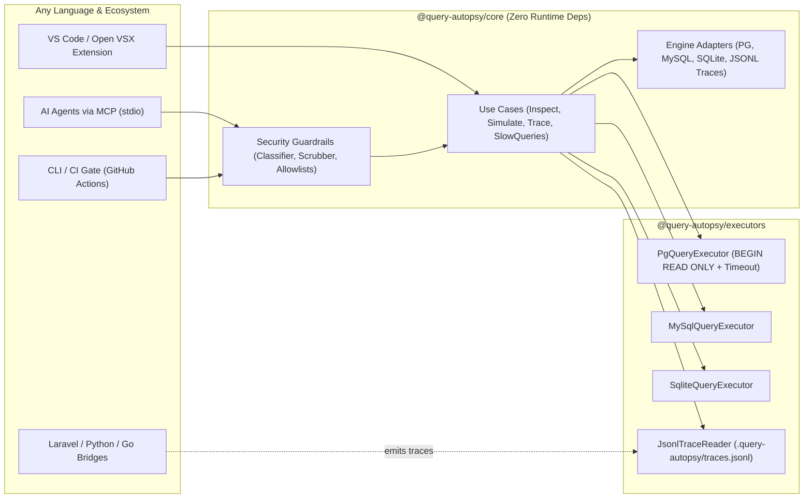

# QueryAutopsy Master Roadmap (`v1.1.0` → `v2.0.0`)

**Role**: Principal Backend Architecture, Security Engineering & Product Strategy  
**Status**: Proposed (`docs/v1.1-to-v2.0-roadmap` — Ready for branch-by-branch execution)  
**Predecessor**: [`ROADMAP-V0.2-TO-V1.0.md`](./ROADMAP-V0.2-TO-V1.0.md) (`v0.2.0` → `v1.0.2` delivered)  
**Related ADR**: [`ADR-0006`](../adr/0006-universal-core-and-zero-trust-mcp-firewall.md)  

---

## 1. Strategic Vision & Positioning

QueryAutopsy evolves from a VS Code extension into a **language-agnostic SQL performance forensics platform** and a **Zero-Trust AI-to-Database Security Firewall**:

> *"Give developers, CI pipelines, and AI coding agents (Cursor, Antigravity, Claude Code, Windsurf) full execution-plan diagnostics across any backend stack — without ever giving AI raw SQL power, exposing production rows, or opening attack paths through developer tooling."*

### Core Design Pillars

1. **One Core, Any Language (`@query-autopsy/core`)**:
   - Do **not** rewrite SQL classification, `EXPLAIN` parsing, diagnostic rules, or plan diffing in PHP, Python, Go, or Ruby.
   - Extract the pure TypeScript `domain/` + `application/` engine into a zero-dependency npm package usable directly from Node/TS, via CLI/CI (`npx`) from any language, or via local `stdio` MCP.
2. **Empower AI Safely (Anti-Vibe-Coding Guardrails)**:
   - Vibe-coders increasingly connect LLM agents directly to databases via generic SQL MCP tools (`run_sql`).
   - QueryAutopsy MCP never replaces raw admin access; it provides **bounded, read-only / estimate-first diagnostic tools** that strip PII literals, scrub cast-error leaks, and mitigate prompt injection.
3. **Zero Regression on Existing VS Code / Open VSX Extension**:
   - Every phase preserves the hexagonal inward dependency rule (`AGENTS.md`) and ships independently via `<type>/<kebab-case-slug>` PR branches.

---

## 2. Target Architecture Topology



### How Every Language Connects Without Rewriting Core Logic

| Stack | Integration Mode | What Runs in the Host Language |
| :--- | :--- | :--- |
| **Node.js / TypeScript** (Prisma, Drizzle, TypeORM, NestJS) | Direct npm devDependency `@query-autopsy/core` + CLI + VS Code CodeLens | Native TS/JS calls in Vitest/Jest integration suites or CI. |
| **Laravel (PHP)** | `onLanguage:php` in VS Code + thin dev-only Composer bridge (`marc14444/laravel-query-autopsy`, ~100 LOC) | `DB::listen()` captures runtime Eloquent queries (`sql`, `bindings`, duration, caller) into `.query-autopsy/traces.jsonl` and flags N+1 bursts; `@query-autopsy/cli` / MCP diagnoses the plans. |
| **Python / Go / Ruby / Java** | Universal JSONL Trace Contract + `@query-autopsy/cli` / `@query-autopsy/mcp` | Optional ~50 LOC framework logger emits standard `.query-autopsy/traces.jsonl` OR AI agent invokes MCP directly on SQL extracted from code / `pg_stat_statements`. |

---

## 3. Threat Model & Anti-Vibe-Coding Security Hardening

Because vibe-coders routinely clone untrusted repositories, paste AI-generated `.env` files, and connect AI agents to local or staging databases, QueryAutopsy MUST act as a defense-in-depth shield.

| # | Threat Vector | Concrete Exposure Observed / Anticipated | Required Countermeasure |
| :--- | :--- | :--- | :--- |
| **1** | **Untrusted Cloned Repos & Malicious `.env` (SSRF / MitM)** | `discoverConnections` scans `.env` / compose files (`DATABASE_URL`). A malicious repo can point to an attacker-controlled DB (leaking SQL schemas/literals or auth handshakes) or inject `?sslmode=no-verify` (`pgQueryExecutor.ts`). | Support VS Code **Workspace Trust** (`capabilities.untrustedWorkspaces`). Block auto-discovery, outbound connections, `ANALYZE`, and `ApplyIndex` in untrusted workspaces. Warn/block `sslmode=no-verify` on non-loopback hosts. |
| **2** | **Plaintext Secrets in Settings (`settings.json`)** | AI assistants asked to "configure DB" often write URIs with passwords into `queryAutopsy.postgres.fallbackConnectionString` instead of `SecretStorage`, risking Git commits. | Reject URIs containing embedded credentials (`user:pass@`) in `fallbackConnectionString` inside `VsCodeConnectionStore.getConnectionString()` and direct users to `SecretStorage`. |
| **3** | **Data Exfiltration via Error Messages in `EXPLAIN ANALYZE`** | Even inside `BEGIN READ ONLY`, a crafted `SELECT (SELECT token FROM users LIMIT 1)::int;` fails with a PostgreSQL cast error containing the leaked column value (`invalid input syntax for type integer: "..."`). | Introduce `sanitizeSqlError()` for AI/MCP outputs (retain SQLSTATE, constraint/relation category, strip data values) and enforce `mode: 'estimate'` as the MCP default. |
| **4** | **Dangerous Functions & Superuser Risk** | Under `SELECT`, local superuser sessions can execute side-effect or I/O functions (`dblink`, `pg_read_file`, `lo_import`, `pg_sleep`) during `EXPLAIN ANALYZE`. Additionally, `PgQueryExecutor.simulateHypotheticalIndex()` currently omits `BEGIN READ ONLY` + `SET LOCAL statement_timeout`. | Wrap `simulateHypotheticalIndex` `EXPLAIN` in `BEGIN READ ONLY` + `SET LOCAL statement_timeout` + `ROLLBACK` in `finally`. Add system-function blocklist checks in `sqlClassifier.ts` and warn when connected as `is_superuser = on`. |
| **5** | **AI Prompt Injection & PII Leakage via MCP** | A table/column/comment (`/* IGNORE PREVIOUS INSTRUCTIONS ... */`) or `WHERE email = 'alice@corp.com'` literal flows into LLM context. | Mandatory `redactSqlLiterals()` (`'...'` -> `'[REDACTED]'` / `$1`), strip SQL comments from MCP responses, strictly separate untrusted DB strings inside typed JSON fields, and **never expose `run_raw_sql`, `applySuggestedIndex`, or `allowWriteAnalyze: true` to MCP**. |
| **6** | **Permissive Functional Index Regex** | `SAFE_PG_CREATE_INDEX_REGEX` currently allows arbitrary `fn(col)` expressions in `CREATE INDEX CONCURRENTLY`. | Restrict functional index expressions to an explicit allowlist of immutable built-in functions (`LOWER`, `UPPER`, `TRIM`, `BTRIM`, `DATE`, `DATE_TRUNC`). |
| **7** | **Exposed Remote Tunnel Attack Surface** | Opening an HTTP/SSE remote MCP tunnel exposes local DBs to port scanning, SSRF, and stolen bearer tokens. | Use **local `stdio` MCP transport only** (zero open TCP ports). Remote tunnels remain explicitly out of scope unless backed by mTLS/OAuth + read-only DB roles. |
| **8** | **npm / Registry Supply Chain Compromise** | `npx` packages targeting developers are high-value targets for token theft. | Keep `@query-autopsy/core` at **0 runtime dependencies**; require maintainer 2FA; publish only from GitHub Actions OIDC with `npm publish --provenance` and Open VSX Trusted Publishing. |

---

## 4. Branch-by-Branch Execution Plan ("Cas par cas")

Every milestone MUST be implemented in its own focused branch off `main` (`<type>/<kebab-case-slug>`) with full test coverage and green checks (`npm run check-types && npm run lint && npm run test && npm run build`).

### Branch 1 — `feat/v1.1.0-security-hardening`
**Goal**: Lock down the existing VS Code extension and build the pure domain security primitives needed by future CLI and MCP adapters.
- **Touched Layers**: `domain/`, `infrastructure/postgres/`, `infrastructure/vscode/`, `package.json`, `tests/`
- **Deliverables**:
  1. `package.json`: declare `capabilities.untrustedWorkspaces` (`limited` support) and guard sensitive commands (`discoverConnections`, `analyze`, `applySuggestedIndex`) behind `vscode.workspace.isTrusted`.
  2. `src/domain/services/sqlClassifier.ts` & new `src/domain/services/sqlSecurity.ts`:
     - Narrow `SAFE_PG_CREATE_INDEX_REGEX` functional expression allowlist (`LOWER`, `UPPER`, `TRIM`, `BTRIM`, `DATE`, `DATE_TRUNC`).
     - Add `detectDangerousPgFunctions(sql)` (`dblink`, `pg_read_file`, `pg_read_binary_file`, `pg_ls_dir`, `lo_import`, `lo_export`, `copy_program`, etc.) and reject before execution.
     - Add pure helpers `redactSqlLiterals(sql, engine)` and `sanitizeSqlError(message, sqlState)`.
  3. `src/infrastructure/postgres/pgQueryExecutor.ts`:
     - Wrap `simulateHypotheticalIndex()` `EXPLAIN` execution in `BEGIN READ ONLY`, `SET LOCAL statement_timeout`, and `ROLLBACK` in `finally`.
     - Reject or require confirmation for `sslmode=no-verify` on non-localhost targets (`127.0.0.1`, `localhost`, `::1`).
     - Detect `is_superuser` during connection check/inspection to warn developers in UI/logs.
  4. `src/infrastructure/vscode/vscodeConnectionStore.ts`:
     - Refuse `queryAutopsy.postgres.fallbackConnectionString` when credentials (`username:password@`) are embedded in plain text.
- **Acceptance Criteria**:
  - Untrusted workspace never touches `.env` or opens DB sockets without explicit trust.
  - Unit tests cover literal redaction, cast-error sanitization, dangerous PG function rejection, restricted index functions, and `fallbackConnectionString` credential rejection.

---

### Branch 2 — `refactor/v1.2.0-monorepo-core-and-cli`
**Goal**: Extract the hexagonal engine into publishable npm workspace packages (`@query-autopsy/core`, `@query-autopsy/executors`, `@query-autopsy/cli`) with **zero regressions** on the VS Code extension VSIX.
- **Deliverables**:
  1. Workspace structure:
     - `packages/core` (`@query-autopsy/core`): `domain/` + `application/` (0 runtime dependencies).
     - `packages/executors` (`@query-autopsy/executors`): PG, MySQL, SQLite executors.
     - `packages/cli` (`@query-autopsy/cli`): `npx query-autopsy explain`, `npx query-autopsy ci` (`--format json|markdown|sarif`, `--fail-on critical`, `--mode estimate|analyze`).
     - `apps/vscode-extension`: existing extension consuming workspace packages via esbuild CJS bundling (`package:vsix` verified identically).
  2. GitHub Actions CI/CD workflow for npm OIDC `--provenance` publishing (triggered strictly on tagged releases).
- **Acceptance Criteria**:
  - `apps/vscode-extension` produces a self-contained `.vsix` identical in features and size budget; all existing unit + Docker E2E tests pass.
  - Any language CI pipeline (Node, Laravel, Python, Go) can run `npx @query-autopsy/cli` via stdin or file flags.

---

### Branch 3 — `feat/v1.3.0-mcp-security-firewall`
**Goal**: Empower AI coding agents safely via a local `stdio` MCP server (`@query-autopsy/mcp`) acting as a read-only / estimate-first firewall.
- **Deliverables**:
  1. New package `packages/mcp` (`npx @query-autopsy/mcp`), transport **`stdio` only** (zero HTTP ports).
  2. Inbound MCP tools wired directly to `packages/core` use cases:
     - `autopsy_explain`: runs `InspectQueryService` (`mode: 'estimate'` by default; `analyze` disabled on `production`-tagged profiles and requires explicit flag `--allow-analyze` at server startup).
     - `autopsy_simulate_index`: runs `SimulateIndexService` (HypoPG what-if verification).
     - `autopsy_list_slow_queries`: runs `FetchSlowQueriesService` (aggregated metadata only).
  3. Built-in Zero-Trust Middleware on all MCP responses:
     - Strips SQL comments, calls `redactSqlLiterals()` on echoed SQL/filters, applies `sanitizeSqlError()` on errors, and forces strict typed JSON outputs (anti-prompt-injection).
     - **Explicitly excludes** `ApplyIndexUseCase` and any raw query / DML execution tool.
  4. Ready-to-copy MCP configuration guides for **Antigravity, Cursor, Claude Code, and Windsurf**.
- **Acceptance Criteria**:
  - Automated security test suite proving MCP refuses DDL, refuses DML writes, refuses unredacted SQL errors, and never exposes `ApplyIndexUseCase`.

---

### Branch 4 — `feat/v1.4.0-universal-trace-contract-and-php`
**Goal**: Support dynamic ORMs across any backend language (starting with PHP/Laravel) using one universal JSONL trace format.
- **Deliverables**:
  1. Pure domain trace schema (`QueryTraceEntry`) and N+1 / slow-burst analyzer in `packages/core`:
     - Format: `.query-autopsy/traces.jsonl` (`{ timestamp, engine, sql, bindings, durationMs, requestId, file, line }`).
     - Detects repeated identical normalized SQL fingerprints within a single `requestId` window (`N_PLUS_ONE_BURST` diagnostic rule).
  2. CLI (`query-autopsy trace`) & MCP tool (`autopsy_analyze_traces`) reading `.query-autopsy/traces.jsonl` and optionally running `EXPLAIN` on top offenders.
  3. Add `php` (`onLanguage:php` + `DB::select` / SQL literal extractor) to `sqlBlockExtractor.ts` and `package.json`.
- **Acceptance Criteria**:
  - Zero runtime language coupling in `packages/core`; detects simulated Laravel/Django/Prisma N+1 trace files cleanly in unit tests.

---

### Branch 5 — `feat/v1.5.0-laravel-composer-bridge`
**Goal**: Publish a lightweight Laravel `--dev` package (`marc14444/laravel-query-autopsy`) that hooks into Eloquent without duplicating any SQL parsing or diagnostic logic.
- **Deliverables**:
  1. Separate lightweight Composer package (`composer require --dev marc14444/laravel-query-autopsy`):
     - Hooks `DB::listen()` when `APP_ENV=local` / `testing` (never enabled in `production` by default).
     - Emits sanitized entries to `.query-autopsy/traces.jsonl` (supporting redaction of bindings before flush).
     - Provides `php artisan query:autopsy` wrapper invoking `npx @query-autopsy/cli` (or surfacing traces to MCP / VS Code).
- **Acceptance Criteria**:
  - Installs cleanly in Laravel 10/11/12; zero impact when `APP_ENV=production`.

---

## 5. Non-Negotiable Invariants Across Every Branch

1. **Never commit or push directly to `main`** (`AGENTS.md` §5). Always work in `<type>/<kebab-case-slug>` PR branches.
2. **Strict Hexagonal Dependency Direction**: `core` never imports `vscode`, `pg`, `mysql2`, `sql.js`, `fs`, or MCP SDK types.
3. **Never downgrade safety defaults**: `estimate`-first for AI/MCP, `BEGIN READ ONLY` + `SET LOCAL statement_timeout` + `ROLLBACK` on `EXPLAIN`, `readOnlyLocked: true` on staging/prod profiles, `SecretStorage` only for credentials.
4. **Full Verification Gate before PR**:
   ```bash
   npm run check-types && npm run lint && npm run test && npm run build
   ```
